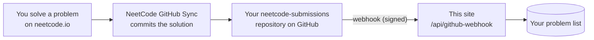
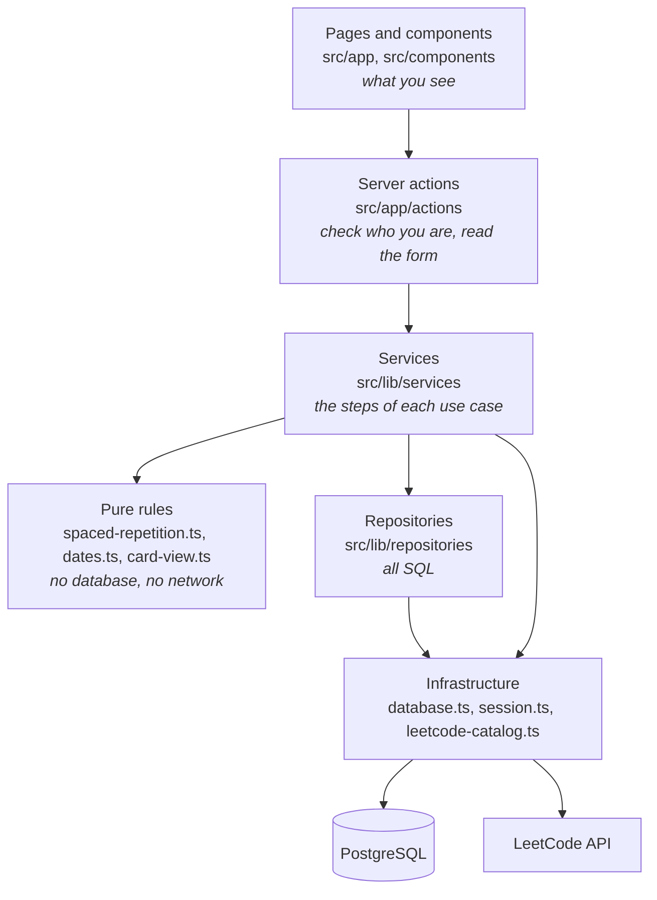

# LeetCode Spaced Repetition

A small website for reviewing LeetCode problems on a spaced repetition schedule.
You type a problem number, the site looks up the problem's name, and it tells you when to solve it again.
It can also add problems on its own: when you solve a problem on [NeetCode](https://neetcode.io), it shows up here automatically.
Each time you solve a problem the gap before its next review grows, so problems you know well show up less and less often.

This README covers what the site does, how to deploy it, how the code is organized, and why it was built this way.
Every folder also has its own README that goes deeper into the code inside it. A good reading order:

1. This file, for the big picture.
2. [`src/lib/README.md`](src/lib/README.md), for the scheduling rules (the heart of the app).
3. [`db/README.md`](db/README.md), for the database design.
4. [`src/app/README.md`](src/app/README.md), for how a click turns into a database change.
5. The rest, as you need them.

---

## Table of contents

- [What the site does](#what-the-site-does)
- [How the schedule works](#how-the-schedule-works)
- [Setting it up on Vercel](#setting-it-up-on-vercel-one-time-about-15-minutes)
- [Adding problems automatically from NeetCode](#adding-problems-automatically-from-neetcode)
- [Updating the site](#updating-the-site)
- [Running it on your own computer](#running-it-on-your-own-computer)
- [The tech stack, and why](#the-tech-stack-and-why)
- [How the code is organized](#how-the-code-is-organized)
- [What happens when you click the circle](#what-happens-when-you-click-the-circle)
- [Design principles in practice (SOLID, DRY, KISS)](#design-principles-in-practice-solid-dry-kiss)
- [Security](#security)
- [Things worth knowing (gotchas)](#things-worth-knowing-gotchas)
- [Ideas for later](#ideas-for-later)
- [Glossary](#glossary)

---

## What the site does

There are two pages.

**Sign in page (`/sign-in`).** You either sign in with email and password, or create an account with first name, last name, email and password.
There's no "Sign in with Google". Accounts are email and password only, by design.

**Problem list (`/`).** Once you're signed in you see:

- A greeting with your name, and a **Sign out** button.
- A box where you type a LeetCode problem number and press **Add problem**. The site fetches the problem's title and difficulty from LeetCode.
- Your problems split into three groups, most urgent first:
  - **Overdue**: past their due date, with the most overdue at the top and a terracotta stripe so they stand out.
  - **Due today**.
  - **Upcoming**: everything due later, soonest first.
- Each problem's title is a link. It opens the problem on **NeetCode** when NeetCode has it, and on **LeetCode** when it doesn't.
  The name you see always comes from LeetCode, since LeetCode has every problem and NeetCode only has some.
- Next to every problem there's a **circle**. Tap it when you've solved the problem. A confirmation pops up ("Did you solve 200. Number of Islands? Its next review will be in 8 days.") so a stray tap doesn't count.
- Once solved today, the circle turns green with a check and is locked until tomorrow.
- A **Remove** button (also with a confirmation) in case you added the wrong number.

If you turn on [NeetCode sync](#adding-problems-automatically-from-neetcode), problems you solve on NeetCode are added to this list by themselves,
exactly as if you'd typed their number on the day you solved them.

It works on phones, tablets and desktops, and follows your device's light or dark mode.
The colors match the Claude workspace: warm off-white background, near-black text, and a muted terracotta accent.

## How the schedule works

The schedule is one list in [`src/lib/spaced-repetition.ts`](src/lib/spaced-repetition.ts):

```ts
export const INTERVAL_DAYS: readonly number[] = [1, 2, 4, 8, 16, 32, 64, 128, 256, 365, 365, 365, 1095];
```

Each problem remembers two things: its **level** (a position in that list) and the **last day you solved it**.
Everything else is calculated from those two values.

1. **Adding a problem counts as your first solve.** It starts at level 0, so it's due again in `INTERVAL_DAYS[0]` = 1 day.
2. **Each solve moves it up one level**: 2 days, then 4, then 8, and so on.
   After the last entry it stays at 1095 days forever.
3. **One step per day.** Once you've solved a problem today, you can't solve it again until tomorrow.
4. **Solving early still counts.** If a problem is due in 4 days and you solve it today, it still moves up.
5. **Falling far behind drops it one level.** If a problem is overdue by *more than its current gap plus the gap before it*, it drops a level.

Worked example of rule 5, with a problem on the 16 day gap (level 4):

| Days overdue | Rule check | What you see | Solving it moves it to |
| --- | --- | --- | --- |
| 10 | 10 > 16 + 8? No | Overdue by 10 days · Every 16 days | 32 days (level 5) |
| 24 | 24 > 24? No | Overdue by 24 days · Every 16 days | 32 days (level 5) |
| 25 | 25 > 24? **Yes** | Overdue by 25 days · Dropped from every 16 days to every 8 days | 16 days (level 4) |

The problem still shows as overdue with its day count. The drop only changes where the next solve takes it.
It drops at most one level, however long you wait. That's the reading of the spec chosen here; the
[`src/lib/README.md`](src/lib/README.md) explains how to change it if you want repeated drops.

**"Today" means today where you are.** The site picks up your browser's time zone when you sign in, so a solve at 11 pm counts for that evening, not for tomorrow in London.

**To change the schedule**, edit that one list and push the change. Nothing else needs to change.

---

## Setting it up on Vercel (one time, about 15 minutes)

You need free accounts on [GitHub](https://github.com) and [Vercel](https://vercel.com). Sign up for Vercel with your GitHub account to make step 1 easiest.

### 1. Put the site on Vercel

1. In Vercel, click **Add New… → Project**.
2. Find this repository in the list and click **Import**.
3. Leave every setting as it is and click **Deploy**. The first deploy will show an error page when you open it.
   That's expected, because the database isn't connected yet.

### 2. Add a database

1. In your Vercel project, open the **Storage** tab.
2. Click **Create Database**, choose **Neon** (Serverless Postgres), and accept the free plan.
3. When it asks which project to connect, pick this one and keep all environments ticked.
   Vercel now stores the database's address for you as an environment variable called `DATABASE_URL`. You never need to copy it by hand.

### 3. Create the tables

1. Still in the **Storage** tab, click your new database, then **Open in Neon**.
2. In Neon, open **SQL Editor** in the left menu.
3. Open [`db/schema.sql`](db/schema.sql) in this repository, copy everything in it, paste it into the editor, and click **Run**.
   It's safe to run again later; it only creates what is missing.

### 4. Add a session secret

The session secret is a long random password the site uses to sign your "you are logged in" cookie. You never type it anywhere else.

1. Make a random string of at least 32 characters. Any password generator works (for example, a 64 character password from your password manager).
   On a Mac or Linux terminal, `openssl rand -hex 32` makes one.
2. In Vercel, open **Settings → Environment Variables**.
3. Add a variable named `SESSION_SECRET`, paste the string as its value, keep all environments ticked, and save.

### 5. Redeploy

Open the **Deployments** tab, click the **⋯** menu on the newest deployment, and choose **Redeploy**.
When it finishes, open your site's address, click **Create an account**, and you're in.

**Keep `DATABASE_URL` and `SESSION_SECRET` private** (and `GITHUB_WEBHOOK_SECRET`, if you set up NeetCode sync). Don't paste them into chats, issues or code.
If one ever leaks, change it in Vercel and redeploy. Changing `SESSION_SECRET` signs everyone out, which is harmless.

## Adding problems automatically from NeetCode

NeetCode has no public API, but it has a **GitHub Sync** feature: every time you submit a solution, NeetCode saves it as a file in a
GitHub repository of yours. GitHub can then send this site a message (a **webhook**) every time that repository changes.
The site reads which problem the new file belongs to and adds it to your list.



Sync never signs in to NeetCode or LeetCode for you, and never reads either site. It only uses features NeetCode and GitHub offer for this.
(Looking up a new problem's title on LeetCode works exactly as it does when you type a number.)

### Only correct solutions count

The site can't run your code, so it relies on NeetCode to only send accepted solutions. **This depends on one NeetCode setting**:
on [neetcode.io/profile/github](https://neetcode.io/profile/github), set the **status filter** to sync **accepted** submissions only.
If it's set to "All", wrong answers get pushed to GitHub too, and the site has no way to tell them apart.

### Setting it up (one time, about 10 minutes)

**1. Turn on NeetCode GitHub Sync.**

1. Sign in on [neetcode.io](https://neetcode.io), open [neetcode.io/profile/github](https://neetcode.io/profile/github), and connect your GitHub account.
   NeetCode creates a repository for your solutions, called `neetcode-submissions` unless you rename it.
2. Turn on **Auto-commit**, and set the status filter to accepted submissions only.

**2. Make a webhook secret.** Like the session secret, it's a long random string, made the same way (`openssl rand -hex 32`, or a password manager).
GitHub uses it to sign every message, and the site rejects any message without a matching signature, so nobody else can add problems to your list.

**3. Tell Vercel about it.** In your Vercel project, open **Settings → Environment Variables** and add two variables:

| Name | Value |
| --- | --- |
| `GITHUB_WEBHOOK_SECRET` | The secret from step 2. |
| `NEETCODE_SYNC_EMAIL` | The email you sign in to this site with. Synced problems go to that account. |

Then redeploy (**Deployments** → **⋯** on the newest one → **Redeploy**), so the site picks up the new variables.

**4. Add the webhook on GitHub.**

1. Open your `neetcode-submissions` repository on GitHub, then **Settings → Webhooks → Add webhook**.
2. **Payload URL**: your site's address followed by `/api/github-webhook`, for example `https://your-site.vercel.app/api/github-webhook`.
3. **Content type**: `application/json`.
4. **Secret**: the same secret from step 2.
5. **Which events**: leave it on **Just the push event**.
6. Click **Add webhook**.

GitHub immediately sends a test message. Refresh the page; a green check next to the webhook means the site answered "Connected."
A red mark usually means the secret doesn't match or the site wasn't redeployed after step 3.

**5. Try it.** Solve any problem on NeetCode, then reload your list. It should be there, marked as solved today.

### What sync does and doesn't do

- **A new problem** is added at level 0 (due tomorrow), the same as typing its number.
- **A problem already in your list** is left alone. Mark reviews with the circle as usual.
- **Bulk Sync** on NeetCode (pushing all your past solutions at once) adds every one of them as solved *today*, because the site can only
  see when the push happened. That's fine for a first import, but expect a busy day of reviews tomorrow.
- **Only the repository's main branch counts**, and only *new* submission files. Edits or deletions on GitHub change nothing here.

### When a problem doesn't show up

Open the webhook on GitHub (**Settings → Webhooks →** your webhook **→ Recent Deliveries**). Each delivery shows the site's answer, for example:

```json
{ "message": "Synced.", "added": [1], "alreadyTracked": [], "notMatched": ["some-new-problem"] }
```

`notMatched` lists NeetCode problems the site couldn't match to a LeetCode number. NeetCode gives many problems its own names
("two-integer-sum" is LeetCode's "Two Sum"), and those names are kept in
[`src/lib/neetcode-problems.ts`](src/lib/neetcode-problems.ts). Add the missing one there with its LeetCode number and push.
Any name that isn't in that table is looked up on LeetCode as is, which works whenever NeetCode uses LeetCode's own name.

The same file decides where each problem's title links to. If a NeetCode problem ever opens on LeetCode instead, or opens a
NeetCode "not found" page, that file is the one place to fix it.
You can also press **Redeliver** on a delivery after the fix to add the problem.

Other answers you might see there:

| Answer | What to do |
| --- | --- |
| 401 "The signature doesn't match" | The secret on the GitHub webhook and `GITHUB_WEBHOOK_SECRET` in Vercel differ. Make them the same and redeploy. |
| 400 "Set the webhook's content type to application/json" | Edit the webhook on GitHub and change **Content type** to `application/json`. |
| 500 "... must both be set" or "No account uses the email" | Check the two Vercel variables, then redeploy. |
| Timed out, after a Bulk Sync | GitHub stops waiting after 10 seconds. Press **Redeliver** until it says "Synced." Each try keeps what earlier tries added, and problems already in your list are skipped. |

## Updating the site

Every change pushed to the `main` branch on GitHub deploys automatically within a minute or two.
Vercel also builds a private preview for every other branch, so you can try a change before merging it.
If a change ever adds new tables or columns, run `db/schema.sql` in the Neon SQL Editor again.

## Running it on your own computer

You need [Node.js](https://nodejs.org) 20 or newer and a Postgres database. Your Neon database works; copy its connection string from the Neon dashboard.

```bash
npm install                   # download the libraries listed in package.json
cp .env.example .env.local    # then fill in DATABASE_URL and SESSION_SECRET
npm run db:setup              # creates the tables (runs scripts/setup-database.mjs)
npm run dev                   # starts the site at http://localhost:3000 and reloads on save
npm test                      # runs the tests in tests/
npm run build                 # the same production build Vercel runs; catches type errors
```

`.env.local` is listed in `.gitignore`, so your secrets never end up on GitHub.

---

## The tech stack, and why

| Piece | Choice | Why |
| --- | --- | --- |
| Language | **TypeScript** | JavaScript with types. The compiler catches mistakes like passing a string where a number belongs, before the code ever runs. |
| Framework | **Next.js** (App Router) with **React** | One project holds both the web pages and the server code, so there's no separate backend to deploy. It's made by Vercel, so deploying needs zero configuration. |
| Database | **PostgreSQL**, hosted on **Neon** | See below. |
| Database driver | **`pg`** (node-postgres) | Plain SQL, no ORM. You can read exactly what query runs. |
| Password hashing | **`bcryptjs`** | The standard, slow-on-purpose password hash. Pure JavaScript, so nothing to compile on Vercel. |
| Sessions | **`jose`** (signed JSON Web Token in a cookie) | No sessions table to manage; the server can check the cookie with just the secret. |
| Tests | **Vitest** | Fast, needs almost no setup, understands TypeScript out of the box. |
| Styling | One plain **CSS file** | The design is simple enough that a CSS framework would add more to learn than it saves. |

### SQL or NoSQL? Why PostgreSQL

The spec left this open, so here's the reasoning.

**The data is relational.** A user has many cards. Each card points at exactly one LeetCode problem. Each card has many solves.
Those "has many" and "points at" relationships are exactly what relational databases are built for,
and SQL `JOIN`s make reading them easy.

**The database should enforce the important rules.** If a rule only lives in application code, any bug or race condition can break it.
Postgres lets us write the rules into the schema, where they can't be skipped:

- `UNIQUE (user_id, problem_number)`: a problem can only be in your list once.
- `UNIQUE (card_id, solved_on)`: a problem can only be solved once per calendar day, even if you double tap on two devices.
- `FOREIGN KEY ... ON DELETE CASCADE`: removing a problem removes its history too, with no orphaned rows.
- `CHECK (level >= 0)`: the level can never go negative.
- **Transactions**: "update the card and log the solve" happens fully or not at all.

**Why not MongoDB?** MongoDB shines when records have flexible, changing shapes, or when data is naturally one big nested document.
Our data has a fixed shape and real relationships between records. In MongoDB, the uniqueness and cross-collection rules above
would have to be rebuilt in application code. For this app that's extra work and extra places for bugs, for no real benefit.

**Why Neon?** It's a hosted Postgres with a free tier, and it plugs into Vercel in two clicks. Nothing else to run or pay for.

The full schema, table by table, is explained in [`db/README.md`](db/README.md).

---

## How the code is organized

```
.
├── db/
│   └── schema.sql                  The database tables
├── scripts/
│   └── setup-database.mjs          Runs schema.sql against DATABASE_URL
├── src/
│   ├── app/                        Pages and server actions (Next.js routing lives here)
│   │   ├── page.tsx                The problem list page  ( / )
│   │   ├── sign-in/page.tsx        The sign in page       ( /sign-in )
│   │   ├── layout.tsx              The HTML shell around every page
│   │   ├── globals.css             All styling
│   │   ├── api/github-webhook/     Where GitHub sends NeetCode sync messages
│   │   └── actions/                Server functions the forms and buttons call
│   ├── components/                 Reusable UI pieces (rows, forms, the confirm dialog)
│   └── lib/                        Everything that isn't UI
│       ├── spaced-repetition.ts    The schedule and its rules (pure logic)
│       ├── dates.ts                Calendar date math (pure logic)
│       ├── card-view.ts            Grouping, sorting and labels (pure logic)
│       ├── services/               Use cases: "add a problem", "solve a card"
│       ├── repositories/           All SQL lives here
│       ├── database.ts             Connection pool and transactions
│       ├── session.ts              The sign-in cookie
│       ├── leetcode-catalog.ts     Looking up problem names on LeetCode
│       ├── github-webhook.ts       Checking and reading GitHub's messages (pure logic)
│       └── neetcode-problems.ts    Which problems NeetCode has, and its names for them
└── tests/                          Automated tests of the rules
```

The code is arranged in **layers**. Each layer only calls the layer below it:



Why bother with layers in an app this size? Because each question you might ask has exactly one place to look:

- "When is a problem due?" → `spaced-repetition.ts`. No SQL or HTML in the way.
- "What query loads my problems?" → `repositories/card-repository.ts`.
- "What does the row look like?" → `components/CardRow.tsx`.

It also makes the most important code the easiest to test. The scheduling rules are plain functions that take values and return values,
so the tests just call them with made-up dates. No database or browser needed.

## What happens when you click the circle

Following one click from start to finish is the fastest way to understand how the pieces connect.

1. **`CardRow.tsx`** (runs in your browser): the click sets `pendingAction` to `"solve"`, which opens the **`ConfirmDialog`**.
   Nothing has been saved yet. Cancel just closes the dialog.
2. You press **Yes, I solved it**. `CardRow` calls **`solveCardAction(card.id)`**.
   That *looks* like a normal function call, but `solveCardAction` is a **server action**:
   Next.js turns the call into an HTTP POST request to the server behind the scenes.
3. **`card-actions.ts`** (runs on the server) reads your session cookie to find out who you are.
   It never trusts the browser to say which user it is. Then it calls **`solveCard(user, cardId)`**.
4. **`card-service.ts`** opens a database **transaction** and asks the repository for the card *with a row lock* (`SELECT ... FOR UPDATE`).
   The lock makes a second, simultaneous click wait its turn instead of reading the same old value.
5. It works out today's date in *your* time zone, then asks the pure rule function **`getLevelAfterSolve(schedule, today)`** for the new level.
   If you already solved it today, the answer is `null` and it stops there.
6. **`card-repository.ts`** runs two SQL statements: `UPDATE cards` (new level and date) and `INSERT INTO card_reviews` (the history row).
   The transaction commits, so both happen or neither does.
7. Back in the action, **`revalidatePath("/")`** tells Next.js the problem list is out of date.
   Next.js re-renders **`page.tsx`** on the server with fresh data and sends it to the browser in the same response.
8. The row moves from "Due today" to "Upcoming" with a green circle. No full page reload happened.

Adding a problem follows the same shape: `AddProblemForm` → `addProblemAction` → `addProblem` service →
(saved problem, or `leetcode-catalog`) → `card-repository.createCard`.

A NeetCode sync reuses that exact path. GitHub calls `api/github-webhook/route.ts`, which checks the signature and reads the file paths
(`github-webhook.ts`). Then `syncNeetcodeSolves` turns each NeetCode name into a LeetCode number and calls the same `addProblem` service.
There's no second copy of the "add a problem" logic.

---

## Design principles in practice (SOLID, DRY, KISS)

These words get thrown around a lot, so here's where each one actually shows up in this code.

### SOLID

- **S: Single responsibility.** Each file has one reason to change.
  `spaced-repetition.ts` changes only if the scheduling rules change. `card-repository.ts` changes only if the SQL changes.
  `CardRow.tsx` changes only if the row's look or behavior changes. A redesign never touches the scheduling math.
- **O: Open for extension, closed for modification.** `leetcode-catalog.ts` tries a list of lookup sources in order (`PROBLEM_SOURCES`).
  Adding a third source means writing one new function and adding it to the list. The loop that tries them doesn't change.
  The schedule is similar: changing `INTERVAL_DAYS` changes the behavior without touching any logic.
- **L: Liskov substitution.** Every lookup source has the same signature, `(problemNumber) => Promise<LeetcodeProblem | null>`,
  so any one can stand in for another. Repository functions that need a transaction take a `DatabaseClient`,
  which can be any object with a `query` method.
- **I: Interface segregation.** Functions ask for only what they use. The rule functions take a `CardSchedule` (`level` and `lastSolvedOn`),
  not a whole card with its title and slug. That's why the tests can build a schedule in one line.
- **D: Dependency inversion.** The pure rules know nothing about the database, the web, or React. The outer layers depend on the rules,
  never the other way around. You could reuse `spaced-repetition.ts` unchanged in a mobile app or a command-line tool.

### DRY (Don't Repeat Yourself)

- The schedule exists in exactly one list. The confirm dialog's "next review in 8 days", the "Every 16 days" label,
  and the actual database update all read from it.
- `getCardStatus` computes due date, overdue days, and the level after a solve in one place.
  `getLevelAfterSolve` reuses it instead of repeating the math.
- `ConfirmDialog` is written once and used for both "Mark as solved?" and "Remove this problem?".
- `FormMessage` shows every error or success message on the site.
- `ActionResult` with `failure()` and `success()` is the one shape every action returns.
- All colors are defined once as CSS variables at the top of `globals.css`. Dark mode just redefines the variables.

### KISS (Keep It Simple)

- **The due date is never stored.** It's always `lastSolvedOn + INTERVAL_DAYS[level]`, computed when needed.
  That means no nightly job to update due dates, and no way for a stored due date to drift out of sync.
- **The level drop is also computed, not stored.** Nothing has to run at midnight to "apply" it.
- **Plain SQL, no ORM.** One less tool to learn, and you can paste any query straight into Neon's SQL editor to try it.
- **One CSS file**, no CSS framework.
- **Native HTML `<dialog>`** for the confirmation popup, instead of a UI library.
  The browser handles focus, the Escape key, and the dark backdrop for free.
- **Dates are plain `"YYYY-MM-DD"` strings.** There's no time-of-day to go wrong (see gotchas below).

KISS also means saying no to features. There's no password reset, no email sending, and no admin page, because nothing asked for them.

---

## Security

- **Passwords are never stored.** Only a bcrypt hash is saved. bcrypt is deliberately slow (12 rounds, roughly half a second per check),
  which makes guessing passwords from a stolen database very expensive. Each hash also includes a random salt,
  so two people with the same password get different hashes.
- **Sign-in errors are vague on purpose.** "That email and password don't match an account" doesn't reveal whether the email exists.
- **The session cookie is signed and `httpOnly`.** Signed means the server can tell if anyone edits it (you can't change your user id to someone else's).
  `httpOnly` means JavaScript on the page can't read it, which blunts cross-site scripting attacks.
  `SameSite=Lax` stops other websites from making requests that carry your cookie. In production it's also `Secure` (HTTPS only).
- **Every action re-checks who you are on the server**, and every SQL query filters by your `user_id`.
  Even if someone sends a request for another person's card id, the `WHERE id = $1 AND user_id = $2` finds nothing.
- **All SQL uses parameters** (`$1`, `$2`, ...), never string building, so SQL injection isn't possible.
  See [`src/lib/repositories/README.md`](src/lib/repositories/README.md).
- **Server actions are protected against cross-site requests** by Next.js, which checks the request's `Origin` header.
- **The NeetCode webhook only trusts signed messages.** GitHub signs each one with `GITHUB_WEBHOOK_SECRET` (HMAC SHA-256), and the site
  compares signatures in constant time (`timingSafeEqual`) so an attacker can't guess one byte at a time. It can only ever add problems
  to the one account in `NEETCODE_SYNC_EMAIL`.

## Things worth knowing (gotchas)

- **Anyone with the link can create an account.** That matches the spec ("a sign in page for any users"). Each person only ever sees their own problems.
  To make the site private to you, the simplest change is to check the email against an allow-list in `createAccountAction`.
- **The LeetCode lookup uses LeetCode's unofficial API.** It's what LeetCode's own website calls, but LeetCode doesn't promise to keep it stable.
  If they change it, adding *new* problems will fail with "Couldn't find LeetCode problem", while everything already in your list keeps working
  (titles are saved in our own `problems` table). The fix would be in `leetcode-catalog.ts` only.
- **Time zones are the classic bug in apps like this.** Servers (including Vercel) run on UTC. At 8 pm in Texas it's already tomorrow in UTC.
  That's why "today" is calculated in each user's own time zone, and why dates are stored as `DATE` (a calendar day with no time) rather than a timestamp.
  See [`src/lib/README.md`](src/lib/README.md) for the details.
- **The `pg` library turns `DATE` columns into JavaScript `Date` objects by default**, which brings time zones right back.
  `database.ts` switches that off so dates stay as `"2026-10-21"` text.
- **Changing `INTERVAL_DAYS` affects existing cards right away**, because due dates are computed from it rather than stored.
  If you shorten the list, cards above the new last level are treated as being at the last level.
- **There's no rate limiting on sign-in.** bcrypt's slowness helps, but a determined attacker could still try many passwords.
  For a personal site this is a reasonable trade-off; see ideas below.
- **NeetCode sync trusts NeetCode's "Accepted only" setting.** The submission files carry no pass or fail marker, so if the setting is "All",
  wrong answers get added too. See [Only correct solutions count](#only-correct-solutions-count).
- **NeetCode sync is for one account.** `NEETCODE_SYNC_EMAIL` names a single user. Supporting several people would mean storing a webhook secret per user.
- **No password reset.** That needs sending email, which needs another service. If you forget your password, you can delete your row
  in the Neon SQL editor and sign up again (your cards are deleted with it, because of `ON DELETE CASCADE`).

## Ideas for later

- A small stats panel (streaks, problems solved this week) built from the `card_reviews` history table, which is already recorded.
- An "undo" for the last solve, also using `card_reviews`.
- Rate limiting sign-in attempts, for example with Vercel's firewall rules.
- Notes per problem (a `notes` column on `cards`).
- An email allow-list, if you want the site private.

## Glossary

- **Spaced repetition**: reviewing something at growing intervals, timed to just before you'd forget it.
- **Server Component**: a React component that runs only on the server. It can query the database directly, and its code is never sent to the browser.
- **Client Component**: a React component that also runs in the browser, so it can respond to clicks and hold state. Marked with `"use client"` at the top.
- **Server Action**: a function marked `"use server"` that the browser can call like a normal function. Next.js turns the call into a POST request.
- **Transaction**: a group of database changes that succeed or fail as one unit.
- **Row lock** (`SELECT ... FOR UPDATE`): makes other transactions wait before changing the same row until this one finishes.
- **Connection pool**: a set of open database connections that get reused, because opening a new one for every query is slow.
- **JWT (JSON Web Token)**: a small piece of data plus a cryptographic signature. Anyone can read it, but only someone with the secret can make a valid one.
- **bcrypt**: a password hashing function that is slow on purpose, to make guessing expensive.
- **Environment variable**: a setting given to the program from outside the code, like `DATABASE_URL`. Keeps secrets out of the repository.
- **Repository (pattern)**: a module whose only job is reading and writing one kind of data in the database.
- **Service (layer)**: the code that carries out one use case, such as "add a problem", by calling repositories and rules in order.
