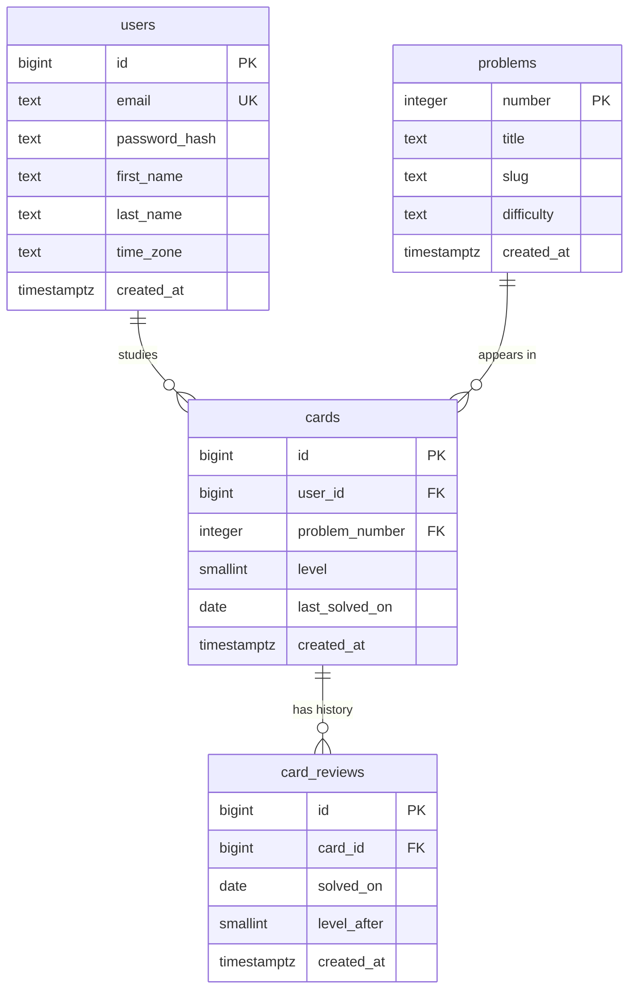

# `db/`: the database schema

This folder holds [`schema.sql`](schema.sql), the one file that defines every table.
You run it once when setting up (by pasting it into Neon's SQL Editor, or with `npm run db:setup`).
Every statement is `CREATE TABLE IF NOT EXISTS`, so running it again is harmless.

For why we use PostgreSQL rather than MongoDB, see the [main README](../README.md#sql-or-nosql-why-postgresql).
This file explains the tables themselves.

## The four tables at a glance



Read the lines as: one user has zero or more cards; one problem appears in zero or more cards; one card has zero or more reviews.

### `users`

| Column | Meaning |
| --- | --- |
| `id` | Auto-generated number that identifies the user everywhere else. |
| `email` | Stored lowercase, and `UNIQUE`, so two accounts can't share one email (and `Kenneth@x.com` and `kenneth@x.com` are the same account). |
| `password_hash` | The bcrypt hash. The real password is never stored. |
| `first_name`, `last_name` | Shown at the top of the problem list. |
| `time_zone` | Like `America/Chicago`. Picked up from your browser each time you sign in. Used to work out what "today" is for you. |
| `created_at` | When the account was made. |

### `problems`

A shared catalog of LeetCode problems: number, title, the URL slug (`two-sum` in `leetcode.com/problems/two-sum/`), and difficulty.

**Why a separate table instead of putting the title on each card?** This is **normalization**: store each fact once.
If 50 users all study Two Sum, its title is stored once, not 50 times. It also means LeetCode is only asked about a problem the
*first* time anyone adds it. After that, the site reads our own copy, which is faster and keeps working even if LeetCode's API is down.

**Why is the primary key the LeetCode number itself**, rather than a separate auto-generated `id`?
Because the number already uniquely identifies a problem and never changes. That's called a **natural key**.
Adding a second, meaningless id would just be one more thing to keep in sync.
(For `users` we *do* use a generated id, because emails can change, and an id that might change makes a bad primary key.)

### `cards`

One row per (user, problem) pair. This is where spaced repetition state lives.

| Column | Meaning |
| --- | --- |
| `user_id` | Whose card this is. |
| `problem_number` | Which problem. |
| `level` | Position in `INTERVAL_DAYS` (see [`src/lib/spaced-repetition.ts`](../src/lib/spaced-repetition.ts)). 0 means the 1 day gap, 4 means the 16 day gap, and so on. |
| `last_solved_on` | The calendar day of the most recent solve (adding counts as the first). |
| `created_at` | When it was added to your list. |

**Notice what's missing: there is no `due_on` column.** The due date is always `last_solved_on + INTERVAL_DAYS[level]`,
so it's computed when the page loads instead of being stored. This is a deliberate choice:

- A stored due date could disagree with the level and last-solved date (two sources of truth). A computed one can't.
- If you change the schedule in `INTERVAL_DAYS`, every card's due date updates automatically.
- Nothing has to run every night to update due dates or apply level drops.

The cost is that sorting by due date happens in TypeScript rather than in SQL. With a few hundred cards, that takes microseconds.

### `card_reviews`

An append-only history: one row every time a card is solved, including the day it was added.
`level_after` records which level the card moved to, so the history alone tells the full story of a card.

It earns its place in two ways:

1. **It's the database-level guard against two solves on one day.** See constraints below.
2. **It makes future features cheap**: streaks, "problems solved this week", or an undo button can all be built from it without changing the schema.

## Constraints: rules the database enforces for us

A **constraint** is a rule the database checks on every insert and update, and refuses any change that breaks it.
The app checks these rules too, but the database is the last line of defense against bugs and race conditions.

| Constraint | Rule it enforces |
| --- | --- |
| `users.email UNIQUE` | One account per email. |
| `cards UNIQUE (user_id, problem_number)` | A problem can only be in your list once. |
| `card_reviews UNIQUE (card_id, solved_on)` | A card can only be solved once per calendar day. |
| `problems CHECK (number > 0)` | Problem numbers are positive. |
| `cards CHECK (level >= 0)` | Levels can't go negative. |
| `cards.user_id REFERENCES users (id) ON DELETE CASCADE` | A card always belongs to a real user. Deleting a user deletes their cards. |
| `cards.problem_number REFERENCES problems (number)` | A card always points to a real problem. |
| `card_reviews.card_id REFERENCES cards (id) ON DELETE CASCADE` | Removing a card removes its history. |

`REFERENCES` creates a **foreign key**: the value must exist in the other table.
`ON DELETE CASCADE` means "when the row I point to is deleted, delete me too", so no orphaned rows are left behind.
Note that `cards.problem_number` has *no* cascade: you can't delete a problem from the catalog while someone is still studying it.

### Why rely on the database and not just the code?

Imagine you tap the circle on your phone and laptop at the same moment. Two requests arrive at the same time.
If the app only checked "was it solved today?" in code, both requests could read "no" before either one saves, and both would count.
The `UNIQUE (card_id, solved_on)` constraint makes that impossible: the second insert fails, and the app turns that failure into
"You already solved this one today." (The app also takes a row lock to avoid even getting that far.
See [`src/lib/services/README.md`](../src/lib/services/README.md).)

## Indexes

An **index** is like the index at the back of a book: it lets the database find rows without reading the whole table.
We don't create any indexes by hand, because the constraints already create the ones we need:

- `PRIMARY KEY` and `UNIQUE` constraints automatically create an index.
- The most common query is "all cards for user X". It's served by the index behind `UNIQUE (user_id, problem_number)`.
  An index on columns `(A, B)` also works for searches on just `A`, because it's sorted by `A` first.
  (This is called the **leftmost prefix** rule.)
- Deleting a card's reviews (by cascade) uses the index behind `UNIQUE (card_id, solved_on)` the same way.

## Column type choices

| Type | Where | Why |
| --- | --- | --- |
| `BIGINT GENERATED ALWAYS AS IDENTITY` | `id` columns | The modern, standard SQL way to auto-number rows (replaces the older Postgres-only `SERIAL`). `BIGINT` so we never run out. `ALWAYS` stops code from inserting its own ids by accident. |
| `TEXT` | names, emails, titles | Postgres stores `TEXT` and `VARCHAR(n)` the same way. Length limits are checked in the app instead, where we can show a friendly message. |
| `DATE` | `last_solved_on`, `solved_on` | A calendar day with no time and no time zone. That's exactly the concept we want, since a problem is due on a *day*. A timestamp would bring back all the time zone bugs. |
| `TIMESTAMPTZ` | `created_at` | An exact moment in time (stored in UTC). Right for "when did this happen", as opposed to "which day is this for". |
| `SMALLINT` | `level` | Levels are tiny numbers; no need for a bigger type. |

## Changing the schema later

There's no migration tool here, to keep things simple. To add something:

1. Edit `schema.sql`. For a new table, add another `CREATE TABLE IF NOT EXISTS`.
   For a new column on an existing table, add a line like `ALTER TABLE cards ADD COLUMN IF NOT EXISTS notes TEXT;` at the bottom.
2. Run the whole file again in Neon's SQL Editor. Existing tables and data are left alone.

If the app grows to many schema changes, a migration tool (such as `node-pg-migrate`) that runs numbered change files in order would be the next step.

## Handy queries to paste into Neon's SQL Editor

```sql
-- Everything in one user's list
SELECT p.number, p.title, c.level, c.last_solved_on
FROM cards c JOIN problems p ON p.number = c.problem_number
JOIN users u ON u.id = c.user_id
WHERE u.email = 'you@example.com'
ORDER BY p.number;

-- Full solve history of one problem
SELECT r.solved_on, r.level_after
FROM card_reviews r JOIN cards c ON c.id = r.card_id
JOIN users u ON u.id = c.user_id
WHERE u.email = 'you@example.com' AND c.problem_number = 1
ORDER BY r.solved_on;
```
